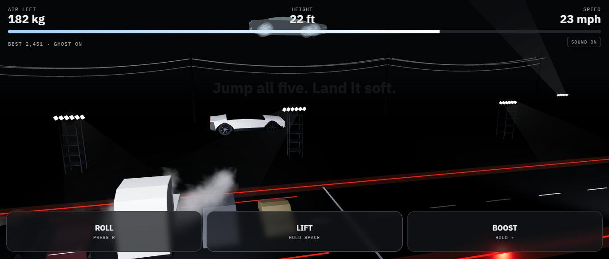

# Flying Roadster Sim

**Play it: [dewashishcodes.github.io/tesla-roadster-sim](https://dewashishcodes.github.io/tesla-roadster-sim/)**

A small browser game based on the flying Roadster reveal from October 2026. You get about 8 seconds of cold-gas thrust. Jump five parked cars, drop off a wall, or see how far you get in endless mode.



Made by [@dewashish.ai](https://www.instagram.com/dewashish.ai/) to go with the reel on how the flying Roadster works. Website: [dewashish-portfolio.pages.dev](https://dewashish-portfolio.pages.dev/)

> Fan-made explainer toy. Not affiliated with or endorsed by Tesla. The physics is simplified.

## Play

It's two static files, so no build step is needed. Serve the folder and open it:

```sh
python -m http.server 8765
# then open http://localhost:8765
```

three.js loads from a CDN (jsDelivr, pinned to 0.169.0).

## Stages

| Stage | What you do |
|---|---|
| 1 · The Kickflip | Jump a Model 3, Model Y, Semi, Cybertruck and Cybercab, then land soft. Barrel rolls score extra. |
| 2 · The Ramp | The suction fans hold you on a curved wall past vertical. Let go, flip upright, roll to face forward, and land on the apron. |
| 3 · Endless | Parked cars, Semis, container stacks, low bridges and trenches. Grab blue air cans and see how far you get. |

## Controls

| Action | Touch | Keyboard |
|---|---|---|
| Lift (corner jets) | hold LIFT | Space / Up |
| Boost (rear jets) | hold BOOST | Right arrow / D |
| Barrel roll, or flip upright on The Ramp | ROLL / FLIP | R |
| Half roll to face forward (The Ramp) | ROLL | E |
| Pick a stage | buttons | 1, 2, 3, Enter |

## The numbers behind it

- **Air:** 250 kg of compressed air in carbon-wrapped tanks (COPVs). Hovering burns about 30 kg/s, so a full tank lasts about 8 seconds. That's our estimate from the reveal coverage, not a Tesla spec.
- **Suction:** the fans hold the car to the wall with up to 2 g, as quoted at the event.
- **Boost:** the rear jets add 16 m/s² of push.
- **Endless:** the tanks also top up slowly while you drive (Tesla said the car recharges its own air).

## How it's built

- Plain three.js in `game.js` with a fixed 120 Hz physics step. It's a side-on 2D model plus the car's orientation.
- The jet plumes and ground clouds are particles that sample a cloud texture baked once at startup, which keeps phones fast.
- All sounds are generated in the browser with Web Audio, so there are no audio files.
- Your best score and a ghost of your best run are saved in `localStorage` on your device, and nothing is sent anywhere.
- The share card is drawn on a canvas at 1080x1920 for Stories.
- Add `?debug` to the URL to get the test hooks (`__sim`, `__state`) used for automated play-testing.

## License

The code is MIT licensed. The mascot artwork (`mascot.png`), the dewashish.ai name and the branding are not covered by MIT: all rights reserved. If you fork this, swap in your own. See [LICENSE](LICENSE).
